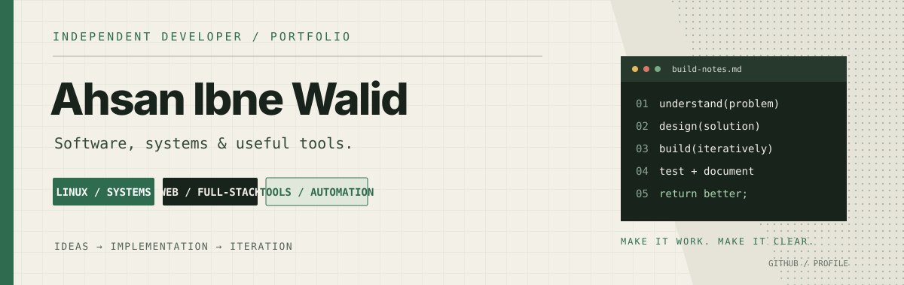

<!-- Profile README: github.com/ahsanibnewalid -->

 

### I turn ideas into software people can actually use.

*Systems · Web platforms · Developer tools · Automation*

---

## 01 / The developer

I’m **Ahsan Ibne Walid**, an independent developer exploring how software works from the system level up to the user interface.

My repositories span Linux utilities, messaging systems, web applications, university workflows, and AI-assisted programming tools. I enjoy connecting the pieces: understanding the problem, building the implementation, making setup less painful, and documenting how it works.

- **Systems:** Linux, C, hardware monitoring, cross-platform desktop software
- **Applications:** JavaScript, TypeScript, Node.js, web interfaces and APIs
- **Product thinking:** usability, practical setup, maintainability, and clear documentation
- **Current interests:** secure communication, campus software, and coding-agent workflows

> I’m learning by building. The projects below have different levels of maturity; each repository is the source of truth for its current status.

## 02 / Selected work

A selection of projects that represent the areas I’m exploring.

<table>
<tr>
<td width="50%" valign="top">

### 🔐 Secure Chat System
**Cross-platform communication**

A text-chat project focused on a manageable server, client connectivity, authentication, TLS, and administration.

[Repository →](https://github.com/ahsanibnewalid/secure-chat-system-with-server)

</td>
<td width="50%" valign="top">

### 🎓 University Platform
**Academic workflows**

A full-stack university-management platform exploring academic structure, role-based access, and institution-wide workflows.

[Repository →](https://github.com/ahsanibnewalid/university-platform)

</td>
</tr>
<tr>
<td width="50%" valign="top">

### 🤖 Programming Action Bot
**AI-assisted development**

An evolving concept for a coding agent that can help plan, investigate bugs, and iterate through software tasks.

[Repository →](https://github.com/ahsanibnewalid/programming-action-bot)

</td>
<td width="50%" valign="top">

### 📈 Linux Hardware Monitor
**Systems & observability**

A Linux utility for inspecting real-time hardware and resource usage.

[Repository →](https://github.com/ahsanibnewalid/Linux-Real-Time-Hardware-Usage-Monitor)

</td>
</tr>
<tr>
<td width="50%" valign="top">

### 💬 GF Chat
**Web messaging experiment**

A browser-based chat project exploring authentication, room messaging, and access-control design.

[Repository →](https://github.com/ahsanibnewalid/gf-chat)

</td>
<td width="50%" valign="top">

### 🧰 Small tools & experiments
**Learning by shipping**

- [Java JDK 8 Installation Script](https://github.com/ahsanibnewalid/Java-JDK-8-Installation-Script)
- [AI Chat Website — Pure JavaScript](https://github.com/ahsanibnewalid/Ai-Chat-website-Using-pure-js)
- [Ultimate POS](https://github.com/ahsanibnewalid/Ultimate-POS)
- [Python experiments](https://github.com/ahsanibnewalid/python)
- [C / terminal project](https://github.com/ahsanibnewalid/Love)

</td>
</tr>
</table>

## 03 / Tools I work with

*These reflect technologies explored across my repositories, not a claim of equal depth or professional experience in every tool.*

## 04 / How I build

| Principle | What it means in practice |
|:--|:--|
| **Start with the user** | Understand who will run the software and what they need to do. |
| **Make setup understandable** | Prefer clear prerequisites, configuration, and troubleshooting steps. |
| **Build in iterations** | Break large goals into smaller changes that can be reviewed and tested. |
| **Document reality** | Keep features, limitations, and build status honest and current. |
| **Treat security as design** | Think carefully about authentication, permissions, secrets, and user data. |

## 05 / Open to collaboration

I’m interested in practical software, Linux and systems programming, web applications, developer productivity, and responsible security learning.

If something here catches your eye, open an issue in the relevant repository. Useful feedback, bug reports, and thoughtful collaboration are welcome.

**Build with intent. Keep it understandable. Improve it continuously.**

Thanks for stopping by — explore a repository and see what’s being built.

