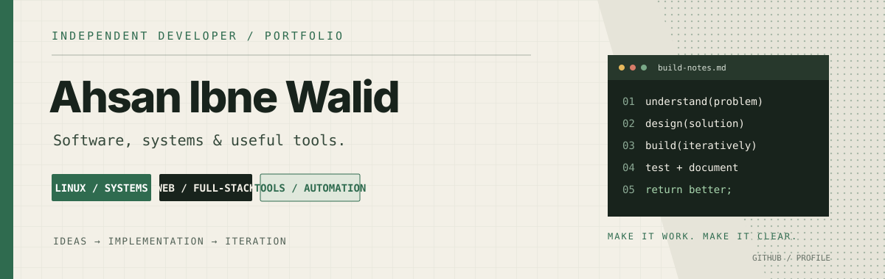

<!-- Profile README for github.com/ahsanibnewalid -->

 

### Software Developer · ICT Educator · Open-Source Believer · Linux Enthusiast

**Building useful software, sharing knowledge, supporting open communities, and enjoying every ride along the way.**

---

## 👋 About Me

I'm **Ahsan Ibne Walid Shuvo** — a software developer, educator, technology enthusiast, and lifelong learner from Bangladesh.

I'm currently a **3rd-year Computer Science & Engineering (CSE) student at Siddheswari College, National University**. Alongside my studies, I work on software projects, teach ICT and practical digital skills, explore Linux and open-source technologies, and share my experiences as a motorcycle enthusiast and moto blogger.

My interests go beyond writing code. I enjoy learning how technology works, helping others become more confident with it, participating in communities, and turning ideas into practical tools.

- 🎓 **Education:** 3rd-year CSE student, Siddheswari College — National University
- 💻 **Development:** Software development, web applications, APIs, automation, and systems programming
- 🧑‍🏫 **Teaching:** HSC ICT instruction and practical ICT / skill-development courses
- 🐧 **Linux:** Linux-based operating systems, command-line tools, customization, and open-source software
- 🌍 **Community:** Strong believer in open source, collaboration, accessible knowledge, and learning in public
- 🏍️ **Moto blogging:** Motorcycle rides, experiences, road stories, and motorcycle culture
- 🤝 **Leadership & community:** Former student politician; interested in communication, teamwork, and community engagement

## What I Do

### 💻 Software Development

I enjoy designing and building practical software that solves real problems. My project interests include:

- Full-stack web applications and backend services
- University, education, business, and productivity systems
- Authentication, authorization, role-based workflows, and administration
- Messaging and client-server applications
- Linux utilities, command-line tools, and systems programming
- Automation, deployment, debugging, and developer tooling

### 🧑‍🏫 ICT Education & Skill Development

I teach **HSC-level ICT** and practical skill-development topics. I believe technology education should be understandable, hands-on, and connected to real-world use.

I enjoy helping learners build strong fundamentals, understand concepts instead of memorizing them, and develop useful digital skills.

### 🐧 Linux & Open Source

I love Linux-based operating systems and the freedom to understand, customize, and improve the tools I use.

I believe open source is about more than code: it's about shared knowledge, transparency, collaboration, and making technology more accessible. I'm always interested in learning from open-source projects and contributing where I can.

### 🏍️ Motorcycles & Moto Blogging

Away from the keyboard, I'm passionate about motorcycles and moto blogging. I enjoy the machines, the journeys, the people, and the stories that come with riding.

## 🧰 Technologies & Tools

*This list reflects technologies I use or explore across projects; it isn't a claim of equal expertise in every tool.*

## 🚀 Selected Projects

Here are a few projects and areas you can explore. Projects evolve over time, so check each repository for its current status, setup instructions, and known limitations.

| Project | What it's about |
|---|---|
| [University Platform](https://github.com/ahsanibnewalid/university-platform) | A university-management platform exploring academic and institutional workflows. |
| [Ultimate POS](https://github.com/ahsanibnewalid/Ultimate-POS) | A point-of-sale and business-management software project. |
| [Manage Social Media](https://github.com/ahsanibnewalid/managesocialmedia) | A social-media management application project. |
| [Secure Chat System](https://github.com/ahsanibnewalid/secure-chat-system-with-server) | Client-server messaging and authentication experiments. |
| [Linux Real-Time Hardware Usage Monitor](https://github.com/ahsanibnewalid/Linux-Real-Time-Hardware-Usage-Monitor) | A Linux utility for monitoring hardware and system resources. |
| [GF Chat](https://github.com/ahsanibnewalid/gf-chat) | A browser-based messaging application project. |
| [AI Chat Website — Pure JavaScript](https://github.com/ahsanibnewalid/Ai-Chat-website-Using-pure-js) | A lightweight browser-based chat experiment. |
| [Programming Action Bot](https://github.com/ahsanibnewalid/programming-action-bot) | An evolving project around programming workflows and automation. |

## 🌱 What I Believe In

- **Keep learning:** Technology changes; curiosity should not.
- **Share knowledge:** What we learn becomes more valuable when we help others learn it.
- **Build for people:** Useful software starts with real needs.
- **Support open source:** Collaboration makes the ecosystem stronger.
- **Stay practical:** Build, test, document, improve, and be honest about limitations.
- **Enjoy the journey:** Progress matters more than pretending to know everything.

## 🤝 Let's Connect & Collaborate

I'm interested in connecting with developers, educators, Linux users, open-source contributors, students, and people building useful things.

If you want to discuss a project, exchange ideas, collaborate on open source, or talk about ICT education and technology, feel free to reach out.

 

**Code with purpose. Teach with passion. Ride with freedom. Believe in open source.**

